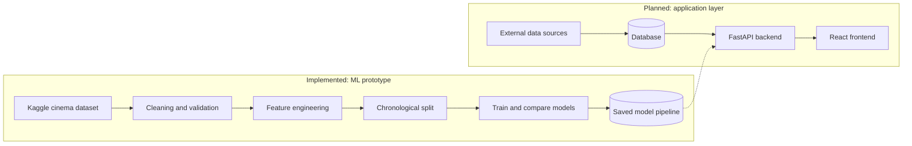

# CineCast AI

**Film business intelligence and cinema demand forecasting, powered by machine learning.**


CineCast AI is a decision-support project for the film business. The long-term idea is one place where producers, investors, distributors and cinema operators can explore movie data, compare titles and see data-driven forecasts.

Today, the part that works is deliberately narrow: a machine-learning prototype that estimates **cinema ticket sales and seat occupancy** from historical cinema records. It is built, validated and saved as a reusable model. Everything else in this README is either in progress or planned, and each section says which.

> [!NOTE]
> **Project status: prototype.** The demand-forecasting model is implemented and validated on a chronological validation split. The API, dashboard, box-office revenue model and other platform modules are not part of the verified prototype yet. The held-out test set has not been scored, so the numbers below are validation results only.

## Contents

- [Where things stand](#where-things-stand)
- [Results at a glance](#results-at-a-glance)
- [Getting started](#getting-started)
- [Why this project](#why-this-project)
- [Platform vision](#platform-vision)
- [Architecture](#architecture)
- [Technology stack](#technology-stack)
- [The dataset](#the-dataset)
- [Machine learning methodology](#machine-learning-methodology)
- [Model performance](#model-performance)
- [Project structure](#project-structure)
- [Installation](#installation)
- [Running the pipeline](#running-the-pipeline)
- [Backend API (planned)](#backend-api-planned)
- [Frontend (planned)](#frontend-planned)
- [Evaluation metrics](#evaluation-metrics)
- [Testing](#testing)
- [Limitations and assumptions](#limitations-and-assumptions)
- [Roadmap](#roadmap)
- [Environment variables](#environment-variables)
- [Reproducibility](#reproducibility)
- [Responsible AI and data privacy](#responsible-ai-and-data-privacy)
- [Contributing](#contributing)
- [Acknowledgements](#acknowledgements)
- [License](#license)

---

## Where things stand

| Area | Status | Notes |
|---|---|---|
| Dataset ingestion (KaggleHub) | Implemented | `arashnic/cinema-ticket` |
| Exploratory data analysis | Implemented | Quality checks, target distribution, daily and weekday patterns |
| Cleaning and feature engineering | Implemented | 142,524 raw records, 142,241 after cleaning |
| Historical occupancy baseline | Implemented | Reference point every model must beat |
| Random Forest and XGBoost | Implemented | Same preprocessing, fair comparison |
| Chronological validation | Implemented | 70 / 15 / 15 split by unique date |
| Saved model pipeline | Implemented | Reloaded and checked: predictions match the in-memory model |
| Final held-out test evaluation | To do | Test period is set aside and not yet scored |
| Inference API (FastAPI) | To do | Design described below |
| React dashboard | To do | |
| Movie metadata (TMDB) | Planned | |
| Box-office revenue model | Planned | Needs its own dataset and target definition |
| Talent analytics | Planned | |
| Financial scenario modeling | Planned | |

## Results at a glance

Random Forest is the current preferred model. On the validation period it is off by about **61 tickets per record** on average, which is roughly **48% lower** error than the historical baseline.

| Model | MAE | RMSE | WAPE |
|---|---:|---:|---:|
| Random Forest | **61.02** | 127.38 | **71.95%** |
| XGBoost | 63.31 | **123.83** | 74.65% |
| Historical occupancy baseline | 116.57 | 211.79 | 137.44% |

These are honest but modest numbers. A WAPE near 72% means a lot of error remains, so treat this as a working prototype rather than a production forecaster. See [Model performance](#model-performance) for the full picture.

---

## Getting started

The quickest way to see the project work is the notebook.

1. Open `ml/notebooks/cinema_ticket_forecasting.ipynb` in Google Colab or Jupyter.
2. Run the cells in order. The notebook downloads the dataset, cleans it, trains the models, compares them and saves the best pipeline.

Once a model is saved, you can predict without any API:

```python
import joblib
import numpy as np
import pandas as pd

model = joblib.load("ml/artifacts/cinema_random_forest.pkl")

record = pd.DataFrame([{
    "film_code": 1492,
    "cinema_code": 304,
    "show_time": 4,
    "capacity": 610.0,
    "ticket_price": 150000.0,
    "day_of_week": 5,
    "day_of_month": 5,
    "month": 5,
    "quarter": 2,
    "is_weekend": 1,
}])

raw = model.predict(record)[0]
tickets = float(np.clip(raw, 0, record.loc[0, "capacity"]))  # keep within capacity

print(f"Predicted tickets: {tickets:.1f}")
print(f"Estimated occupancy: {tickets / record.loc[0, 'capacity'] * 100:.1f}%")
```

> [!WARNING]
> Only load `.pkl` files that you created or trust. Pickle files can execute code when loaded.

---

## Why this project

Film is a business with a lot of uncertainty. Producers and investors have to judge how a movie might perform, and cinema operators have to guess how many people will turn up so they can plan screens, staff and seating.

Underestimate demand and you miss sales. Overestimate it and staff and screens sit idle. CineCast AI explores how far historical data and machine learning can narrow that uncertainty.

**What the project sets out to do**

- Build reproducible machine-learning pipelines for film-business questions.
- Compare predictive models against simple historical baselines, not just against each other.
- Validate time-dependent data chronologically so the model never trains on the future.
- Present predictions in an interpretable way, with limitations and uncertainty stated openly.
- Grow into a user-friendly analytics interface that supports, rather than replaces, human decisions.

## Platform vision

The wider platform is organized around six modules. Only the last one has a working prototype today.

| Module | What it is meant to do | Status |
|---|---|---|
| Movie intelligence | Search titles, explore genres, cast, crew, ratings and posters | Planned |
| Box-office analytics | Domestic, international and worldwide revenue, budgets, trends by genre and year | Planned |
| Revenue forecasting | Estimate revenue with low, expected and high scenarios | Planned |
| Movie comparison | Compare budgets, revenue, ratings and engagement; find similar historical titles | Planned |
| Talent analytics | Historical performance linked to actors and directors | Planned |
| Cinema demand forecasting | Estimate ticket sales and occupancy from cinema records | **Prototype** |

Two points are worth stating clearly:

- **Revenue forecasting needs a defined target** before any modeling, such as opening-weekend revenue or worldwide gross within a set period. Revenue, profit and return on investment are different quantities and will not be treated as interchangeable.
- **Talent analytics shows historical association, not cause.** It can show how films with a given actor or director performed, but not that the person caused the result.

---

## Architecture

The diagram separates what exists today from what is planned.



Solid arrows inside the prototype describe the working notebook. The dashed arrow shows how the saved model is intended to be loaded by the backend. Components in the planned box are not part of the verified prototype.

## Technology stack

| Category | Technologies | Status |
|---|---|---|
| Language | Python | In use |
| Data processing | pandas, NumPy | In use |
| Visualization | Matplotlib, Seaborn | In use |
| Machine learning | scikit-learn, XGBoost | In use |
| Model serialization | Joblib | In use |
| Development environment | Google Colab, Jupyter Notebook | In use |
| Version control | Git, GitHub | In use |
| Backend | FastAPI | Planned |
| Frontend | React, Vite, Tailwind CSS, Recharts | Planned |
| Database | PostgreSQL | Planned |
| Movie metadata | TMDB API | Planned |

---

## The dataset

| | |
|---|---|
| **Dataset** | Cinema Ticket |
| **Provider** | Kaggle, [`arashnic/cinema-ticket`](https://www.kaggle.com/datasets/arashnic/cinema-ticket) |
| **File** | `cinemaTicket_Ref.csv` |
| **Size** | 142,524 records, 14 columns (142,241 records after cleaning) |
| **Period** | 21 February 2018 to 4 November 2018 |
| **Download** | KaggleHub |

```python
import os
import kagglehub
import pandas as pd

path = kagglehub.dataset_download("arashnic/cinema-ticket")
ds = pd.read_csv(os.path.join(path, "cinemaTicket_Ref.csv"))

print(ds.shape)
print(ds.head())
```

> [!IMPORTANT]
> Check the dataset's current license and usage terms on Kaggle before redistributing the data or committing it to a public repository.

### What the exploratory analysis found

- **Data quality is good overall.** Of 142,524 records, 125 had missing `capacity` and `occu_perc`, 54 had zero or negative capacity, and 106 were exact duplicates. In total 283 records (about 0.2%) were removed.
- **The target is heavily skewed.** Half of all records sold 50 tickets or fewer, three quarters sold 143 or fewer, and the largest sold 8,499.
- **Occupancy is low for the typical record.** Average occupancy is about 20%, though some records exceed 100%, so estimated capacity is not a hard ceiling.
- **There is a clear weekly rhythm.** Tuesday has the highest average sales per record, and weekends are not the peak.
- **The history is short.** It covers roughly eight and a half months of one year, so yearly seasonality and holidays cannot be learned.
- **Some columns need clarification.** `capacity` looks derived rather than a physical seat count, and `show_time` behaves more like a count or slot index than a clock time.
- **Coverage is very thin in the first weeks** (late February to early March).

Identifiers such as `film_code` and `cinema_code` are anonymized. The dataset has no titles, genres or cast, and none should be inferred from the codes.

### Additional planned data sources

| Source | Intended use |
|---|---|
| TMDB API | Movie metadata, genres, cast, release dates, posters |
| IMDb datasets | Ratings, vote counts, movie information |
| Kaggle | Historical budgets and box-office datasets |
| The Numbers | Box-office financials, subject to licensing |
| OMDb API | Supplementary movie information |

Access to a source does not grant permission to redistribute its data. Each source's terms and licensing conditions must be followed.

---

## Machine learning methodology

### The prediction task

**Target:** `tickets_sold`

**Objective:** estimate the number of tickets sold for a historical cinema record, using movie, cinema, showtime, capacity, price and calendar information. Occupancy is then derived as predicted tickets divided by capacity.

### Input features

| Feature | Type | Description |
|---|---|---|
| `film_code` | Categorical | Movie identifier |
| `cinema_code` | Categorical | Cinema identifier |
| `show_time` | Categorical | Encoded showtime |
| `capacity` | Numeric | Available seating capacity |
| `ticket_price` | Numeric | Ticket price |
| `day_of_week` | Numeric | Day of the week (0 = Monday) |
| `day_of_month` | Numeric | Day of the month |
| `month` | Numeric | Month |
| `quarter` | Numeric | Calendar quarter |
| `is_weekend` | Numeric | Weekend indicator |

`capacity` and `ticket_price` are assumed to be known at the time a prediction is made.

### Preventing target leakage

These columns are excluded from the model inputs because they come from actual sales outcomes:

- `occu_perc`
- `total_sales`
- `tickets_out`
- `ticket_use`

`ticket_use` in particular has the same quartiles and maximum as `tickets_sold`, so it would hand the model the answer.

### Cleaning rules

1. Parse `date` into a datetime and drop records with invalid dates.
2. Drop records with negative `tickets_sold` or non-positive or missing `capacity`.
3. Drop exact duplicate rows.
4. Sort chronologically.
5. Derive `day_of_week`, `day_of_month`, `month`, `quarter` and `is_weekend` from the date.

### Chronological split

Time-ordered data should not be split randomly, because the model could learn from days that come after the ones it is tested on. The split is made on **unique dates**, not on individual rows.

| Set | Share of dates | Period | Records |
|---|---:|---|---:|
| Training | 70% | 21 Feb to 23 Aug 2018 | 100,201 |
| Validation | 15% | 24 Aug to 29 Sep 2018 | 19,353 |
| Test | 15% | 30 Sep to 4 Nov 2018 | 22,687 |

The validation set is used to compare models. The test set stays untouched until the final model is chosen.

### Models

**1. Historical occupancy baseline.** For each combination of movie, cinema and showtime, it takes the average occupancy seen in training. Unseen combinations fall back to the overall training occupancy. Predicted tickets are occupancy multiplied by capacity, capped at capacity.

**2. Random Forest regressor.** Captures nonlinear relationships between identifiers, capacity, price and calendar features.

**3. XGBoost regressor.** A gradient-boosting alternative.

| Setting | Random Forest | XGBoost |
|---|---|---|
| Trees / estimators | 200 | 500 |
| Maximum depth | 15 | 6 |
| Minimum samples to split | 5 | n/a |
| Minimum samples per leaf | 2 | n/a |
| Learning rate | n/a | 0.03 |
| Minimum child weight | n/a | 3 |
| Row / column subsample | n/a | 0.8 / 0.8 |
| Regularization (L1 / L2) | n/a | 0.1 / 1 |
| Random seed | 42 | 42 |

### Preprocessing

Both models share one scikit-learn `Pipeline`, so preprocessing is saved together with the model and applied identically at training and inference time.

- **Numeric features:** median imputation.
- **Categorical features:** most-frequent imputation, then one-hot encoding with `handle_unknown="ignore"`, so unseen categories do not crash inference.
- **Predictions** from all models are clipped between 0 and the record's capacity.

---

## Model performance

All figures below are **validation** results (24 August to 29 September 2018, 19,353 records).

| Model | MAE | RMSE | WAPE |
|---|---:|---:|---:|
| Historical occupancy baseline | 116.57 | 211.79 | 137.44% |
| Random Forest | 61.02 | 127.38 | 71.95% |
| XGBoost | 63.31 | 123.83 | 74.65% |

### Model selection

Random Forest has the lowest MAE and WAPE, so it is the current preferred model. XGBoost has a slightly lower RMSE, which means it is marginally better at avoiding very large misses. The choice is provisional until the held-out test evaluation is done.

### How to read the numbers

Compared with the baseline, Random Forest reduces:

- MAE by about **47.7%**
- RMSE by about **39.9%**
- WAPE from **137.44%** to **71.95%**

The remaining WAPE shows that errors are still substantial. Because the target is so skewed, RMSE is best read alongside MAE and WAPE rather than on its own.

> [!IMPORTANT]
> These are validation results, not final held-out test results. Final test metrics must be added after the independent test evaluation.

### Saved artifacts

| File | Contents |
|---|---|
| `cinema_random_forest.pkl` | Complete pipeline: preprocessing and Random Forest |
| `model_metadata.pkl` | Model name, validation metrics, feature list and random seed |

After saving, the pipeline was reloaded and its validation predictions were confirmed to match the in-memory model.

---

## Project structure

This is the proposed layout. Adjust it to match the files actually in your repository.

```text
CineCast-AI/
├── frontend/                 # React app (planned)
│   ├── public/
│   ├── src/
│   │   ├── components/
│   │   ├── pages/
│   │   ├── services/
│   │   ├── hooks/
│   │   └── assets/
│   └── package.json
│
├── backend/                  # FastAPI service (planned)
│   ├── app/
│   │   ├── main.py
│   │   ├── routes/
│   │   ├── schemas/
│   │   ├── services/
│   │   └── config/
│   └── requirements.txt
│
├── ml/
│   ├── notebooks/
│   │   └── cinema_ticket_forecasting.ipynb
│   ├── preprocessing/
│   ├── training/
│   ├── evaluation/
│   └── artifacts/
│       ├── cinema_random_forest.pkl
│       └── model_metadata.pkl
│
├── data/
│   └── README.md             # how to obtain the data; no raw data committed
│
├── tests/
│   ├── test_preprocessing.py
│   ├── test_model.py
│   └── test_api.py
│
├── docs/
│   ├── architecture.md
│   └── report.pdf
│
├── .env.example
├── .gitignore
└── README.md
```

Do not commit restricted datasets, credentials or unnecessarily large generated files. Model artifacts can be large, so consider Git LFS or release assets rather than committing them directly.

---

## Installation

### Prerequisites

- Python 3.10 or a compatible version supported by your dependencies
- Git
- Node.js and npm (frontend only)
- PostgreSQL (only if the database integration is enabled)
- API credentials for external data providers (only for enabled integrations)

### 1. Clone the repository

```bash
git clone <YOUR_REPOSITORY_URL>
cd CineCast-AI
```

### 2. Create a Python environment

```bash
python -m venv venv
```

macOS / Linux:

```bash
source venv/bin/activate
```

Windows:

```bash
venv\Scripts\activate
```

### 3. Install dependencies

To run only the notebook prototype:

```bash
pip install pandas numpy matplotlib seaborn scikit-learn xgboost joblib kagglehub
```

For the backend, once it exists:

```bash
pip install -r backend/requirements.txt
```

### 4. Install the frontend (when available)

```bash
cd frontend
npm install
cd ..
```

### 5. Configure environment variables

Copy `.env.example` to `.env` and fill in values only for the integrations you enable. See [Environment variables](#environment-variables).

---

## Running the pipeline

Run the notebook cells in order. They will:

1. Load the dataset.
2. Run data-quality checks and exploratory analysis.
3. Clean the data and engineer calendar features.
4. Define the target and input features.
5. Split the data chronologically.
6. Train the historical baseline.
7. Train Random Forest and XGBoost.
8. Compare validation metrics.
9. Save the selected pipeline and its metadata.

### Saving the model

```python
import os
import joblib

os.makedirs("ml/artifacts", exist_ok=True)

joblib.dump(rf_model, "ml/artifacts/cinema_random_forest.pkl")

joblib.dump(
    {
        "model_name": "Random Forest",
        "MAE": 61.018655,
        "RMSE": 127.377495,
        "WAPE": 71.946904,
        "features": features,
        "random_state": 42,
    },
    "ml/artifacts/model_metadata.pkl",
)
```

### Loading and verifying the model

```python
import joblib
import numpy as np

model = joblib.load("ml/artifacts/cinema_random_forest.pkl")

reloaded = np.clip(model.predict(X_val), 0, val_df["capacity"].values)
print("Predictions match:", np.allclose(reloaded, rf_predictions))
```

> [!NOTE]
> KaggleHub may ask for Kaggle credentials depending on your environment. If it does, follow its documentation to configure them.

---

## Backend API (planned)

The backend will use FastAPI to serve predictions and application data. The endpoints below are a **proposed design**, not a claim that they already exist.

| Method | Endpoint | Purpose |
|---|---|---|
| GET | `/health` | Health check |
| GET | `/movies/search` | Search movie metadata |
| GET | `/movies/{movie_id}` | Retrieve movie information |
| POST | `/predict/demand` | Predict cinema ticket demand |
| POST | `/predict/revenue` | Predict box-office revenue |
| GET | `/analytics/overview` | Retrieve an analytics summary |

### Example demand request

The field names match the model's features. Ticket price is shown on the scale used in the dataset (typically tens of thousands), since the dataset does not state a currency.

```json
{
  "film_code": 1492,
  "cinema_code": 304,
  "show_time": 4,
  "capacity": 610,
  "ticket_price": 150000,
  "day_of_week": 5,
  "day_of_month": 5,
  "month": 5,
  "quarter": 2,
  "is_weekend": 1
}
```

### Example response

```json
{
  "predicted_tickets": 42.0,
  "capacity": 610,
  "predicted_occupancy": 6.89,
  "predicted_remaining_seats": 568.0,
  "model": "Random Forest"
}
```

> [!WARNING]
> This response is an illustration of the schema, **not** an actual model prediction.

The API should warn callers when a movie or cinema code has not been seen before, or has little history, since predictions for those inputs are less reliable.

## Frontend (planned)

The frontend is planned with React, Vite, Tailwind CSS and Recharts. It is intended to provide:

- A film-business analytics dashboard
- Movie search and detail pages
- Revenue forecasting forms
- Movie comparison visualizations
- A cinema demand prediction tool
- Financial performance charts
- Model evaluation and prediction summaries

For the demand tool, movies should be shown with neutral labels such as "Movie 101", sending the matching `film_code` to the model, because the dataset contains no titles.

Once the frontend exists:

```bash
cd frontend
npm run dev
```

Then open the local URL printed in the terminal.

---

## Evaluation metrics

**Mean Absolute Error (MAE)** is the average absolute difference between actual and predicted ticket sales, in tickets.

$$
\text{MAE} = \frac{1}{n}\sum_{i=1}^{n}\left|y_i-\hat{y}_i\right|
$$

**Root Mean Squared Error (RMSE)** also reports error in tickets but penalizes large misses more heavily.

$$
\text{RMSE} = \sqrt{\frac{1}{n}\sum_{i=1}^{n}\left(y_i-\hat{y}_i\right)^2}
$$

**Weighted Absolute Percentage Error (WAPE)** is total absolute error relative to total actual sales.

$$
\text{WAPE} = \frac{\sum_{i}\left|y_i-\hat{y}_i\right|}{\sum_{i}\left|y_i\right|}\times 100
$$

Every reported metric is calculated on validation or test data that was kept separate from training.

---

## Testing

Tests should cover the preprocessing pipeline, the saved model, prediction behavior and, later, the API.

```bash
pytest tests/
```

**Verified in the notebook**

- The saved model reloads and gives the same validation predictions as the in-memory pipeline.

**Recommended test cases**

- Missing values are handled correctly.
- Categorical encoding works as expected.
- Unknown movie or cinema codes do not crash inference.
- Predictions are finite numbers.
- Predictions respect capacity when clipping is enabled.
- Invalid API input, such as zero capacity, is rejected.
- Training and inference use the same feature schema.

Tests should run against the real trained artifact and representative inputs rather than hard-coded expected predictions.

---

## Limitations and assumptions

**Dataset**

- Records carry anonymized movie and cinema identifiers, not genre, cast, budget or marketing information.
- The history covers about eight and a half months of 2018, so yearly seasonality and holiday effects cannot be learned.
- Historical sales may not reflect future market conditions or other cinema chains, regions and pricing strategies.

**Predictions**

- There are no booking timestamps, so no specific advance-booking horizon can be claimed.
- New movies and cinemas, or rarely seen combinations, have no learned history and will be less reliable.
- Promotions, competing releases, weather and local events are not modeled.
- Validation WAPE of about 72% limits how far any single estimate can be trusted.

**Financial forecasting**

The planned revenue module will need a separate dataset and methodology, with budget, cost, marketing, release information and the forecast target defined up front.

**Operational assumptions**

- Capacity and ticket price are assumed known when a prediction is made.
- Predictions support decisions; they do not make them. Human review is required before business or financial action.

---

## Roadmap

**Near term**

- Score the held-out test period and report final test metrics.
- Analyze large errors, low-demand records and unseen-code cases.
- Confirm what one dataset record and `show_time` represent.
- Build and test the FastAPI inference endpoint.

**Machine learning**

- Develop a dedicated box-office revenue model.
- Evaluate CatBoost and other gradient-boosting approaches.
- Add SHAP-based explanations.
- Improve cold-start handling.
- Add prediction intervals and uncertainty estimates.
- Perform segment-wise error analysis.

**Film intelligence**

- Integrate TMDB metadata and IMDb ratings.
- Add movie similarity recommendations.
- Add actor, director and genre performance analysis.

**Financial analytics**

- Add budget and revenue scenario modeling.
- Estimate profitability and ROI.
- Explore release-date and competition analysis.

**Application**

- Build interactive React dashboards.
- Add PostgreSQL persistence and automated data ingestion.
- Add authentication and user workspaces.
- Deploy the application.

---

## Environment variables

Create a `.env.example` file with placeholders:

```env
TMDB_API_KEY=your_tmdb_api_key
DATABASE_URL=your_database_url
BACKEND_URL=http://localhost:8000
```

Only configure variables for integrations that are actually implemented. Never commit real API keys, passwords, tokens or private credentials.

## Reproducibility

The workflow is set up to be repeatable:

- Fixed random seed: `42`
- Chronological training, validation and test splits
- Scikit-learn pipelines for consistent preprocessing
- Saved model artifacts with metadata
- Documented hyperparameters
- Identical feature definitions in training and inference

To reproduce the results, re-run the notebook from a clean environment. Pin the scikit-learn and XGBoost versions used for training, because pickled models can be sensitive to library versions.

## Responsible AI and data privacy

CineCast AI is a decision-support tool, and it is built with that in mind. The project aims to:

- Use public or appropriately licensed datasets.
- Avoid collecting unnecessary personal information.
- Respect the terms of external APIs and dataset licenses.
- Document limitations and possible sources of bias.
- Avoid presenting uncertain predictions as guaranteed outcomes.
- Keep people responsible for final operational and financial decisions.

## Contributing

Feedback and suggestions are welcome. If you find a problem or have an idea, please open an issue first so we can talk it through before any larger change.

## Acknowledgements

- Kaggle, for hosting the cinema ticket dataset
- TMDB, for the planned movie metadata integration
- IMDb, for its publicly available non-commercial datasets
- The scikit-learn and XGBoost teams
- The FastAPI and React communities
- The open-source contributors whose tools make this project possible

## License

Add the license chosen for the CineCast AI source code here.

Third-party datasets, movie metadata, images and APIs remain subject to their own licenses and terms of use. The project license does not override those restrictions.

---

## Author

**CineCast AI**, film business intelligence and cinema demand forecasting.

- GitHub: `<YOUR_GITHUB_PROFILE>`
- Repository: `<YOUR_REPOSITORY_URL>`
- Demo: `<YOUR_DEMO_URL>`
- Documentation: `<YOUR_DOCUMENTATION_URL>`

*CineCast AI aims to bridge the gap between film-industry data and predictive decision-making, bringing movie intelligence, financial analytics and machine learning together in one platform.*
